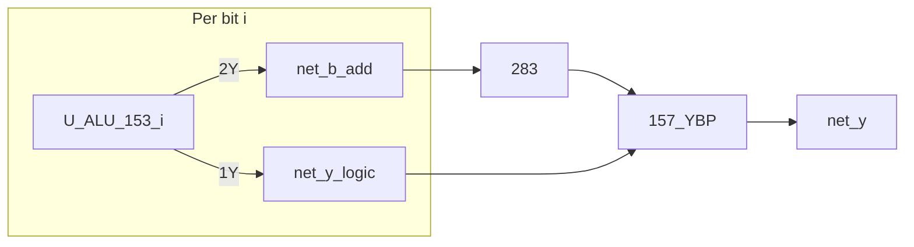

# ALU Phase B — 153 mux1 / mux2 bit-slice (logic + B_CTRL)

**Status:** **implemented** (2026-07)  
**Netlist:** frozen `alu8` block (12 DIP, B_CTRL bit-slice)

## Architecture

| Layer | Blocks | Role |
|-------|--------|------|
| **B-path** | `U_ALU_153_i` mux2, `283×2`, `157_YBP×2` | SUB/ADD/INC/DEC/CMP **Y** |
| **Logic** | `U_ALU_153_i` mux1 | AND/OR/XOR/NOT/PASS via operand select |
| **CMP** | `ALU_CMP_SUB` | Z/C_GE from SUB (`Y==0`, `net_c_hi`) — no 7485 |
| **Glue** | `ALU_Y_MUX_SEL` | `net_y_mux_sel = s0 \| s1` → 157 picks sum vs logic |

Each bit `i` uses one **74HC153** (`U_ALU_153_i`):

| Mux | Pins | Role |
|-----|------|------|
| **mux1** | `1C0..3` = `net_lgc*`, `1Y` = `net_y_logic[i]` | Logic select |
| **mux2** | `2C0..3` = `net_bctrl*`, `2Y` = `net_b_add[i]` | B_CTRL data inputs |
| **A/B** | `net_a[i]`, `net_b[i]` | Operand select |

## Operand select (shared 153 A/B pins)

All opcodes: `A = net_a[i]`, `B = net_b[i]`.  
`sel = A | (B<<1)` drives both mux1 and mux2.

## mux1 logic table (per bit)

| sel | A | B | Result |
|-----|---|---|--------|
| 0 | 0 | 0 | C0 |
| 1 | 1 | 0 | C1 |
| 2 | 0 | 1 | C2 |
| 3 | 1 | 1 | C3 |

### Opcode → C0..C3 (`net_lgc0..3`, shared 8-bit)

| Op | lgc0 | lgc1 | lgc2 | lgc3 | Notes |
|----|------|------|------|------|-------|
| NOP | 0 | 0 | 0 | 0 | logic=0; sum 선택이므로 물리 Y=A, CPU hold |
| AND | 0 | 0 | 0 | 1 | A&B |
| OR | 0 | 1 | 1 | 1 | A\|B |
| XOR | 0 | 1 | 1 | 0 | A^B |
| NOT | 1 | 0 | 1 | 0 | ~A, B 무관 |
| PASS_A | 0 | 1 | 0 | 1 | A, B 무관 |
| PASS_B | 0 | 0 | 1 | 1 | B, A 무관 |
| ADD/SUB/INC/DEC/CMP | * | * | * | * | Unused; `157_YBP` selects **sum** |

제어 프리셋의 Python 원본: `simulators/cyclesim/blocks/alu8.py`. [b3-opcode.md](../hw-bringup/b3-opcode.md)는 현재 LUT 비트 순서로 정합화한 벤치 표다. 2026-07-04 벡터는 일부 입력만 검사한 과거 기준이며 전 입력 검증을 대신하지 않는다.

## B_CTRL mux2 (`net_bctrl3..0` → `2C3..2C0`)

| Opcode | bctrl[3:0] | Behaviour |
|--------|------------|-----------|
| ADD | `1100` | B[i] pass |
| SUB/CMP | `0011` | ~B[i] (no 74HC04) |
| DEC | `1111` | constant 1 |
| INC | `0000` | B_add=0; **`net_cin=1`** → A+0+1 |

## Critical path

**SUB / CMP (Y)** @ max (pre-flight sim):  
`net_b0` → `U_ALU_153_0.B` → `2Y` → `283` → `157_YBP` → `net_y0` — **136 ns**.

**INC (Y)** @ max: `net_cin` → `283` → `157_YBP` — **153 ns** (system worst-case).

**Logic** @ max: `U_ALU_153_0.1Y` → `157_YBP` — **46 ns**.

## IC budget (DIP)

| Part | Qty |
|------|-----|
| 74HC283 | 2 |
| 74HC153 (bit-slice) | **8** |
| 74HC157 (YBP) | 2 |
| **ALU total** | **12** |

(Plus behavioral glue: `Y_MUX_SEL`, `CMP_SUB`.)

## Regen

Netlists and timing gates are **frozen** in normative docs (2026-07-04).
