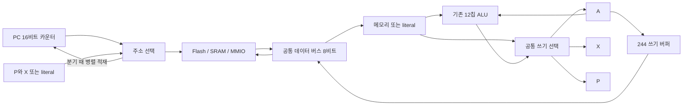

# RAM 명령 중심의 74 CPU 축소 실험

**2026-10-24 · 새 ISA 실행 후보.** 기존 v1.0 인코딩을 유지하는 115개 구성에서
**74HC 60개**로 줄였다. 프로그램 Flash 1개와 SRAM 2개를 합하면 **63 IC**다.
실제 부품 연결을 생성하고 명령·프로그램을 실행한 수량이며, CPLD와 제어 ROM은 없다.
12칩 ALU와 기존 64 KiB Boot/Run/MMIO 메모리 맵을 포함한다.

근거: [ram_ttl.py](../../simulators/cyclesim/hybrid/ram_ttl.py),
[독립 ISA 해석기](../../simulators/cyclesim/hybrid/ram_isa.py),
[실행·집계 결과](../../simulators/cyclesim/hybrid/ram-ttl-evidence.json).
기존 [v1.0 CU](cpld-sequential-cu.md)는 별도로 유지한다. 새 바이너리가 필요하며,
기존 assembler·OS·호출 규약의 포팅까지 완료한 결과는 아니다.

## 1. 칩을 줄인 RAM 명령과 데이터 경로

주소는 `P:low`다. `P`는 8비트 페이지 레지스터, `low`는 명령의 두 번째 바이트 또는
8비트 `X`다. 별도 16비트 주소 가산기 없이 64 KiB 전체에 접근한다.

- `LDA [P:offset]`: RAM 데이터를 AC인 `A`에 직접 쓴다.
- `LDX [P:offset]`, `LDP [P:offset]`: RAM에 저장한 포인터를 주소 레지스터에 직접 읽는다.
  AC를 거치지 않아 데이터와 포인터를 함께 유지할 수 있다.
- `ADD/SUB/CMP/AND/TEST [P:offset]`: RAM 데이터를 ALU B로 바로 사용한다. MBR을 없앤다.
- 위 명령에 indexed 비트를 켜면 `P:X`로 접근한다. X는 **페이지 안의 하위 주소**이며,
  offset에 X를 더하는 방식이 아니다. 자동 증감이나 자동 페이지 넘김도 없다.
- `STA [P:offset]` 또는 `STA [P:X]`: A를 공통 8비트 데이터 버스로 출력한다.
  다른 레지스터마다 버스 출력 버퍼를 붙이지 않는다.



**8비트 데이터 버스는 유지하지만, PC 적재 방식은 바꿨다.** 이미 메모리에 나가는
16비트 주소선을 PC 카운터의 병렬 입력에도 연결한다. 이전처럼 PC의 hi/lo를 데이터
버스로 왕복하지 않는다. 이는 추가 16비트 데이터 버스나 숨겨진 target 래치가 아니다.
PC 증가는 161 네 개가 맡으며 ALU를 점유하지 않는다.

저장소는 A/X/P/D/IR 다섯 바이트, PC 16비트, 단계 카운터와 플래그·HALT다.
MBR·RESULT·MAR/ADDR·TMP·임시 RP 레지스터는 없다. D는 두 번째 명령 바이트다.
RP 자체는 RAM `$0F00/$0F01`에 남으며 소프트웨어가 읽고 갱신한다.

## 2. 최소 명령 형식

모든 명령은 **opcode + literal/offset의 2바이트**다. 아래는 대표 인코딩이다.
`[addr]`는 기본 `P:literal`, opcode에 `$80`을 더하면 `P:X`다.
즉시값 명령은 indexed 비트를 무시한다.

| Opcode | 명령 | 동작 |
|---|---|---|
| `$00 / $01 / $02` | LDI / LXI / LPI | 즉시값을 A / X / P에 적재 |
| `$04 / $05 / $06` | LDA / LDX / LDP | `[addr]`를 A / X / P에 적재 |
| `$10` | STA | A를 `[addr]`에 저장 |
| `$08 / $09 / $0A` | ADDI / SUBI / CMPI | A와 즉시값 연산, CMP는 A 보존 |
| `$0C / $0D / $0E` | ADD / SUB / CMP | A와 `[addr]` 연산, CMP는 A 보존 |
| `$28 / $2A` | ANDI / TESTI | A와 즉시값 AND, TEST는 A 보존 |
| `$2C / $2E` | AND / TEST | A와 `[addr]` AND, TEST는 A 보존 |
| `$03 / $07 / $0B` | JMP / JZ / JC | 무조건 / Z / C일 때 PC ← addr |
| `$0F` | HALT | 명령 완료 후 정지 |

ALU 명령만 Z/C를 갱신한다. SUB/CMP의 C는 **borrow 없음**, AND/TEST의 C는 0이다.
LPI는 플래그를 보존하므로 `CMPI → LPI target_hi → JZ target_lo`가 가능하다.
LDP의 메모리 주소는 **적재 전 P**로 계산한다.

opcode를 명령마다 비교하는 대신 비트를 제어에 직접 사용한다.
bit 4는 STORE 우선 선택, bit 5는 ALU의 AND/TEST 선택, bit 6은 무시,
bit 7은 indexed 선택이다. STORE에서는 bit 0..3/5를 무시한다.
bit 4가 0이면 아래쪽 4비트가 위 표의 종류를 선택한다. ALU 그룹에서 bit 5가 1이면
ADD/SUB 모두 AND가 되고 CMP는 TEST가 된다. 나머지 그룹에서는 bit 5를 무시한다.
이 중복 인코딩도 전부 정의하고 검사한다. v1.0의 reserved-op trap을 유지하지 않는다.

### RAM 포인터 사용 예

RAM `$2200/$2201`에 little-endian 포인터가 있다면:

```text
LPI $22
LDX $00        ; X ← RAM[$2200], A는 보존
LDP $01        ; P ← RAM[$2201], 읽기는 기존 P=$22로 수행
LDA [P:X]      ; 실제 대상 읽기
```

같은 페이지의 여러 변수는 LPI 한 번 뒤 offset만 바꾸어 접근한다. 페이지를 자주 바꾸는
프로그램은 LPI가 늘어난다. 16비트 포인터 증감과 carry/borrow는 소프트웨어로 처리한다.

## 3. 부품 합산

두 수량 모두 현재 연결 생성기를 실행한 결과다. 기능을 기준으로 묶어 중복 없이 센다.

| 기능 / 부품 | v1.0 유지 직접 쓰기 | 새 RAM ISA |
|---|---:|---:|
| ALU: 153×8 + 283×2 + 157×2 | 12 | 12 |
| 바이트 레지스터 377 | 11 | 5 |
| 플래그·정지 상태 574 | 1 | 1 |
| 카운터 161 | 2 | 5 |
| 데이터 버스 출력 244 | 8 | 1 |
| 디코더 238 | 6 | 1 |
| 나머지 게이트·MUX·메모리 디코드 | 75 | 35 |
| **74HC 합계** | **115** | **60** |
| Flash 1 + SRAM 2 | 3 | 3 |
| **CPU 논리 + 메모리 IC** | **118** | **63** |

74HC는 **55개, 47.83% 감소**했다. 저장 레지스터 감소보다 제어·MUX·버스 출력 감소가 크다.
X/literal 주소 선택 MUX 두 개만 빼는 비교 구성은 58개지만 X 간접 주소를 잃는다.
RAM 포인터와 소프트웨어 복귀에 유용한 **60개 구성을 선택**했다. 58개는 다른 부분까지
제거·재설계한 최소 구성이나, 여기 실험 프로그램을 그대로 실행하는 구성이 아니다.

63개는 발진기, 외부 RESET/WAIT 신호원, 부하 버퍼, mailbox MCU, 수동부품을 제외한
CPU 논리+메모리 수량이다. 이 범위는 115개 비교 기준과 같다. 완성 보드 전체 BOM이나
최대 클록·fanout이 확정되었다는 뜻은 아니다. 실제 부품 종류별 수량과 모든 기능 핀은
재현 출력의 `comparison.json`, `netlist.json`에서 확인한다.

## 4. 제어와 실행 비용

인출과 실행을 겹치지 않는다. 고정 여섯 단계는 opcode setup/capture,
literal setup/capture, execute setup/capture다. PC는 앞의 두 capture에서 각각 증가하고,
명령은 마지막 capture에서 완료한다. WAIT는 메모리 capture를 연기하며 접근을 반복하지 않는다.

| 새 ISA 프로그램 | 코드 바이트 | 완료 명령 | tick | 확인 결과 |
|---|---:|---:|---:|---|
| 반복 Fibonacci(13) | 54 | 205 | 1,230 | A 및 RAM 결과 233 |
| RAM 포인터로 페이지 경계 넘어 4바이트 복사 | 162 | 64 | 384 | A0..A3 복사, 포인터 `$20FE→$2102` |
| 재귀 Fibonacci(3), 스택 검사 포함 | 954 | 684 | 4,104 | 결과 2, RP `$F600` 복구 |

WAIT가 없을 때 새 ISA의 native MIPS는 **클록 MHz / 6**이다. 가령 2 MHz를 가정하면
0.333 MIPS지만, 보드에서 그 클록이 성립한다고 검증한 값은 아니다. 기존 ISA와 명령 수가
달라 MIPS만으로 프로그램 처리량을 비교할 수 없다.

**소프트웨어 CALL/RET는 비용이 크다.** 현재 매크로는 A를 보존하고 X/P/Z/C를 바꾼다.
호출별 전개 코드는 CALL 152바이트, RET 216바이트이며 공통 오류 처리 24바이트가 별도다.
RP=`$F600` CALL은 52명령/312tick, RP=`$F602` RET는 75명령/450tick이다.
하위 바이트 carry/borrow와 경계 검사 경로에 따라 달라진다.

같은 재귀 Fibonacci(3)의 기존 115개 회로는 107명령/2,744tick, 새 회로는
684명령/4,104tick으로 **tick이 49.56% 늘었다**. 양쪽을 각각 독립 해석기와 대조해 실행했다.
칩 감소를 모든 프로그램의 속도 향상으로 해석하면 안 된다.

소프트웨어는 기존 RP 범위·2바이트 정렬·overflow/underflow를 검사하며, 오류면 스택 본체를
변경하기 전에 `$0F05`에 오류 번호를 쓰고 HALT한다. `$0F02..$0F04`는 A·복귀주소 scratch다.
임의 프로그램은 이 검사를 생략할 수 있으므로 **하드웨어 강제 검사와 동등하지 않다**.
재귀 예제의 지역 변수는 RP 하위 바이트로 배치한 데모이며 깊이 128 미만에 한정한다.

## 5. 초기화·검증 범위

외부 RESET을 최소 한 클록 동안 유지하면 실제 161의 clear와 HALT 입력 로직으로
PC/T/HALT가 초기화되고 `$0000`에서 시작한다. 초기 A/X/P/flags를 하드웨어가 지운다고
가정하지 않으며 boot 코드가 초기화한다. v1.0의 `$FFFC` reset-vector fetch는 구현하지 않는다.
벡터 주소의 Boot/Run 메모리 맵은 유지된다. HALT의 PC도 v1.0과 달리 두 바이트 뒤를 유지한다.

검증은 모든 opcode 256종×플래그 4조합, 산술·논리 경계, PC wrap, WAIT·HALT 정지,
모든 페이지의 memory CE와 벡터 경계, Boot 쓰기 차단, 실제 reset 핀, RAM 실행,
포인터 증감 wrap, 재귀·스택 경계 및 ALU/PC 고장 주입을 포함한다.
명령마다 독립 해석기와 레지스터·전체 메모리·접근 주소/값/순서를 대조한다.
새 후보 **1,157개 테스트**, 기존 직접 쓰기·부품·netlist 회귀 **276개**, 총 **1,433개**가 통과했다.

모델의 호스트는 클록과 메모리 소자만 제공한다. PC 증가·분기·ALU·레지스터 enable은
74 연결로 결정한다. RAM과 Flash 자체는 기능 메모리 모델이며, 일반 논리와 ALU는
부품 진리표 기반이다. RAM→ALU→레지스터의 setup/hold, SRAM WE 종료 때 주소 hold,
clock skew, 전기적 bus turnaround는 실물/타이밍 검증 대상이다.

저장소 루트에서 재현한다:

```powershell
.\.venv\Scripts\python.exe -X utf8 -m simulators.cyclesim.hybrid.ram_measure
.\.venv\Scripts\python.exe -X utf8 -m pytest -q simulators/cyclesim/tests/test_ram_ttl.py
```

생성 파일은 `simulators\cyclesim\build\ram-ttl\comparison.json`과 `netlist.json`이다.
netlist에는 60개 논리 칩 및 세 메모리의 기능 핀 연결을 넣었으며 tri-state driver 노드를
실제 공통 버스로 합쳤다. IC 패키지의 물리 pad 번호나 PCB 배치도는 아니다.
소스·netlist SHA-256을 [보존한 결과](../../simulators/cyclesim/hybrid/ram-ttl-evidence.json)와
대조하면 집계의 기준 버전을 확인할 수 있다.

## 6. 같은 ISA를 CPLD에 분할한 후속 실험

보유한 ATF1504 두 개와 ATF1502 한 개를 사용한 [CPLD 구성](../../simulators/cyclesim/hybrid/ram-cpld.md)은
**ALU 74HC 12개 + CPLD 3개 + 메모리 3개 = 18 IC**다. 위 63개 구성에서 45개 줄었다.
페이지 레지스터를 ATF1502의 메모리 디코더와 함께 배치해 주소부의 용량을 맞췄다.
세 CPLD 모두 WinCUPL vendor fitter에서 `Design fits successfully`와 정격 안의 자원 보고를 확인했다.
이 결과는 현재 새 ISA 후보에만 적용한다.

즉시값은 CU가 공통 데이터 버스로 내보내므로 ALU 앞의 operand MUX도 없앤다.
상위 주소는 fetch capture에서 주소 CPLD, execute capture에서 페이지 CPLD가 구동하며,
중간 setup 단계는 양쪽이 모두 해제한다. 이 연결로 프로그램의 결과·메모리 trace·tick이
74 전용 모델 및 독립 해석기와 일치했다. 여전히 명령당 6tick이며 소프트웨어 CALL/RET를 유지한다.
핀 사용량, 역할 분담, 재현 명령과 물리 검증 경계는 위 CPLD 문서를 따른다.

ATF1502를 빼는 직접 대체 구성도 같은 문서에서 비교한다. 페이지 레지스터용 74HC173×2와
디코더용 74HC 5개가 대신 들어가므로 **ATF1504×2 + 74HC 19개 + 메모리 3개 = 24 IC**다.
두 1504의 fit, 전체 Boot/Run 주소 디코딩과 프로그램 실행을 확인했으며 최소 수량의 증명은 아니다.

교육용 후속 [IR·카운터 외부화 비교](../../simulators/cyclesim/hybrid/ram-educational.md)는
ATF1504 두 개만 사용한다. IR·단계 카운터 외부화는 **29 IC**, PC까지 포함하면 **35 IC**다.
두 안 모두 핀 예산을 맞추기 위해 AC·writeback MUX·DB 드라이버·zero 검출도 외부에 배치했다.
같은 명령·프로그램의 6클록 동작을 유지하며 CPLD fit, 부품 기능 실행, 동일 기준의 연결 수를
비교한다. 실제 배치 점퍼 수·최대 클록 검증과는 구분한다.
